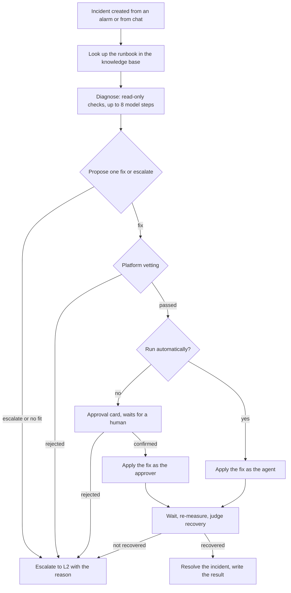

# MATRIX: Agent Behavior and Action Lifecycle

| Field | Value |
|---|---|
| Document ID | AIG-001 |
| Owner | MATRIX product owner |
| Approver | `[to be named]` |
| Version / status | 0.1 / Draft |
| Classification | Internal; shareable after review |
| Effective date | 18 November 2026 |
| Review frequency | At every release, and whenever a tool, a fix or a risk rule changes |
| Applicable product version | MATRIX AIOps (this repository, `main`) |
| Related | PRD-001, ARC-001, SEC-001, RSK-001 |

## 1. Purpose

This document says **what the agent is allowed to do, how it decides, and what happens at each step**. It is written for the
people who approve, audit or change the agent's behavior.

## 2. The agent in one sentence

For an incident on one server, the agent reads the matching runbook, runs read-only checks, proposes **one** fix from a fixed
list, has the platform check it, applies it (or asks a human), checks that the problem went away, and then resolves the
incident or hands it to L2.

## 3. The action lifecycle

| Step | What happens | If it fails |
|---|---|---|
| 1. Start | "Investigation started" note on the ticket | |
| 2. Runbook | The alarm text is matched against the knowledge index; the best match is quoted in the notes with its confidence | If `RAG_REQUIRED` is on and the match is below `RAG_MIN`, escalate. By default it carries on without a runbook |
| 3. Diagnose | The model may call only the read tools: health check, top CPU processes, disk, service status, alarms, knowledge search, CMDB lookup, incident timeline. Each result is written to the ticket | After 8 steps without a decision, or no decision, escalate |
| 4. Propose | The model calls `propose_fix` with one action, or `escalate` | |
| 5. Vet | Code checks the proposal (section 5) | Escalate with "rejected by safety checks" |
| 6. Decide | Automatic or human approval (section 6) | |
| 7. Apply | The fix runs through the scoped executor role over SSM | An error escalates |
| 8. Verify | Wait 15 seconds, re-run the health check and the relevant read tool, ask the model to judge recovery from the live output (section 7) | Escalate |
| 9. Close | Resolve the incident with a note; add an inbox event for the console | |

## 4. The fix list

The autonomous agent can do only these. Nothing else is reachable from an alarm.

| Fix | Limit |
|---|---|
| `restart_service` | Only services in the `SERVICES` setting (for example nginx, httpd, crond, amazon-cloudwatch-agent) |
| `clear_old_logs` | Runs the log-cleanup playbook, which deletes by age |
| `kill_process` | One process whose PID and exact name appear in the diagnostics, and that is not on the never-kill list |

Everything else (patching, migration, deployment, decommission, playbooks, AWS changes) is available in **chat only**, with
Confirm and a ticket (`tool-catalog.md`).

## 5. Vetting: the model is not trusted

| Check | Rule |
|---|---|
| Fix is on the list | An action that is not one of the three is rejected |
| Service | Must be in `SERVICES` |
| Process | PID is 2 to 7 digits, the name is not on the never-kill list (systemd, init, sshd, SSM agent, dbus, cron, kernel threads and similar), and `PID  name` must appear in the tool output the agent actually saw |
| Server | Must exist, carry `matrix-managed=true` and the right `environment` |
| Ticket | The incident must be real and open |

A proposal that fails any check is escalated. The model's own words are never executed.

## 6. Automatic or human approval

| Case | Result |
|---|---|
| Dev environment (tag `environment` or `Environment`, either spelling) and the fix is not `kill_process` | Runs automatically |
| The same alarm was auto-resolved at least `AUTO_AFTER` times before (default 3) | Runs automatically (a known pattern) |
| Anything else, including every `kill_process` that is not a known pattern, and every non-dev server | An approval card appears in the console; a human must Confirm or Reject |

A human approval runs the fix **as that person**; the note says who approved it. Approvals expire with the 30-day record.

### 6.1 Working without a runbook, and trying twice

- On a **dev** server with no matching runbook, the agent still works, using only the fixed fix list. On any other server, no matching runbook means escalation.
- If a fix is applied and recovery is not confirmed, the agent looks again with what it learned and may try **one different** safe fix (same approval rules) before it escalates. It never repeats the same fix.
- If every check shows the problem has already gone and the alarm is back to **OK**, the agent writes "nothing to fix" on the ticket and closes it itself ("no action needed"). If the alarm state is not clearly OK, it escalates instead.

## 7. Judging recovery

After a fix the agent waits 15 seconds, re-runs the health check and the read tool that matches the fix, and asks the model
to decide "fixed: yes or no" from those live outputs.

- The model is told that a CloudWatch alarm still in ALARM right after the fix **does not count** as failure, because alarms
  change state minutes later. It must judge from the live measurements: the guilty process is gone and CPU, load, memory,
  disk or the service are back to normal.
- If the answer is yes, the incident is resolved with a note starting "MATRIX AI auto-resolved".
- If it is no or unclear, the incident is escalated.
- This judgment is the weakest part of the design. If the fix did not work, the alarm stays in ALARM and CloudWatch sends no
  new event; the open incident and the L2 escalation are the safety net.

## 8. Escalation

An escalation sets the incident to In Progress, reassigns it to the L2 group (`L2_GROUP`), writes the reason as a work note,
and adds an escalation event in the console. The console shows it under **Escalated to L2** until an engineer takes
ownership (moves it to **Assigned to engineers**) or resolves it.

## 9. Chat and planned work

| Class | Rule |
|---|---|
| Read tool | Runs at once; the result is returned and noted on the ticket |
| Write tool | The engineer sees an action card and must press Confirm; the ticket number is verified first |
| Planned work (patch, migrate, deploy, decommission) | Needs Confirm **and** an approved, scheduled change. With `CHANGE_MODE=incident`, an open incident is accepted and Confirm is the approval |
| Decommission terminate | Needs a stopped server for the hold period (default 7 days), a backup image, a human-applied tag `decommission-approved=true`, and the optional decommission role |
| Resize and terminate in the normal role | Refused by the role itself |

**Tickets are opened for the engineer.** A request to restart, reboot, start, stop or kill, or planned work such as migration, deployment or decommission, makes MATRIX open an incident in code (the chat never asks the engineer for a number). Only open tickets (New, In Progress, On Hold) are reused; a resolved ticket is never reused. After Confirm, a successful simple action resolves the ticket with a plain note. A **failed** action never resolves it: the ticket stays open with a note. Long jobs (images, patching, migration, deployment, decommission) leave the ticket open until the engineer or the agent closes it.

The chat model is told never to invent a ticket number, never to retry with a different number after a refusal, and to stop
after the same tool error twice.

## 10. Learning from outcomes

When an escalated incident is later resolved by a human, MATRIX drafts a knowledge article and a playbook from the ticket.

1. Automatic checks run: no secrets, no dangerous commands (reboot, broad kill, firewall changes, user changes and similar), declared parameters, no unsafe defaults.
2. A draft that **fails a check is blocked** and cannot be approved; a person can reject it or ask for changes.
3. Otherwise a human approves in the Knowledge page. Approval publishes the article to ServiceNow and the playbook as an SSM document.
4. Learned playbooks are **not** added to the agent's allow-list automatically.

## 11. Model behaviour and failover

- The agent uses the primary model, then same-key extras, then up to three standbys. A rate limit, server error, rejected
  key (401, 403) or missing model (404) parks that model for a while and the next one is tried.
- Short, simple chat messages use a smaller model if one is configured.
- Tool descriptions are trimmed to what the conversation needs, to save tokens.

## 12. What the agent never does

- Act on a server that is not tagged `matrix-managed=true` for the right environment.
- Terminate, resize or change IAM with the normal executor role.
- Approve its own change, or reuse a closed ticket.
- Put passwords, tokens or keys into a work note.
- Run a command it did not read in tool output (for kill) or that is not in a fixed list.

## Change history
| Version | Date | Author | Summary | Approval |
|---|---|---|---|---|
| 0.1 | 18 Nov 2026 | Product owner | First draft from the code and the observed runs | Pending |
