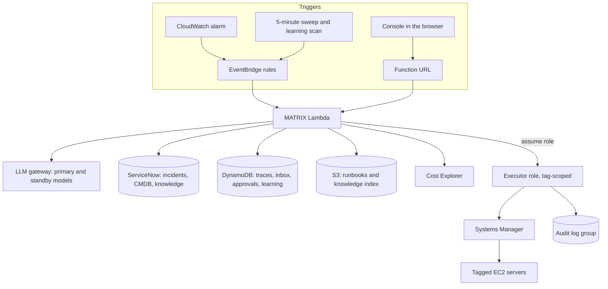

# MATRIX: Architecture and Governance Overview

| Field | Value |
|---|---|
| Document ID | ARC-001 |
| Owner | MATRIX product owner |
| Approver | `[to be named]` |
| Version / status | 0.1 / Draft |
| Classification | Internal; shareable after review |
| Effective date | 18 November 2026 |
| Review frequency | At every release, and after any change to roles, tools or the fix list |
| Applicable product version | MATRIX AIOps (this repository, `main`) |
| Related | PRD-001, AIG-001 (agent behavior), SEC-001 (threat model), RSK-001 (stop procedure), DEP-001 (deployment) |

## 1. The design in one paragraph

MATRIX is **one AWS Lambda** that does everything: it serves the console's API, runs the autonomous agent, receives CloudWatch
alarms, talks to the models and ServiceNow, and runs the learning loop. State lives in managed services (DynamoDB, S3,
ServiceNow). Actions on servers go through **Systems Manager** using a **scoped IAM role**. The model never acts directly:
it proposes, and code checks and runs.

## 2. Components

| Layer | What it is | Source files |
|---|---|---|
| Entry and routing | `lambda_function.handler` sends alarm events and scheduled tasks to their handlers and everything else to the console API | `lambda_function.py` |
| Console API | Sign-in, incidents, chat, dashboard, knowledge, cost | `console_api.py`, `metrics.py`, `matrix_console_extras.py`, `matrix_cost_action.py` |
| Alarm intake | Alarm to incident to agent, with a duplicate guard and a sweep | `matrix_alarm_intake.py` |
| Autonomous agent | Diagnose, propose one fix, vet, apply or ask, verify, resolve or escalate | `autonomy.py`, `aiops.py` |
| Chat tools | Read tools run at once; write tools need Confirm and a ticket | `aiops.py`, `awsops.py`, `matrix_sre_*` |
| Planned work | Patching, migration, deployment, decommission | `matrix_ops_skills.py`, `matrix_ops_install.py`, `matrix_change.py`, `matrix_mode.py` |
| ServiceNow | Ticket, CMDB, knowledge and change tools | `matrix_snow_tools.py` |
| Guardrails | Ticket check, instance tag check, command class, role assumption, audit | `matrix_guardrails.py` |
| LLM gateway | Primary, same-key extras, up to three standbys, small-talk model, failover | `gateway.py` |
| Knowledge | Retrieval of runbooks for the agent, and ServiceNow and SSM views | `rag.py`, `matrix_console_extras.py` |
| Learning loop | Drafts an article and a playbook from resolved escalations, with checks, for human approval | `learning.py` |

## 3. Data and where it lives

| Data | Store | Kept |
|---|---|---|
| Tickets, work notes, knowledge articles, CMDB | ServiceNow | Permanent (the record of truth) |
| Traces, inbox events, pending approvals, learning drafts | DynamoDB trace table (point-in-time recovery on) | 30 days, then expire |
| Projects, chat sessions, usage | DynamoDB tables | Until deleted |
| Runbooks and the retrieval index | S3 ops bucket | Until deleted; bucket kept on stack delete |
| Action audit | CloudWatch audit log group | Per log group retention |
| Playbooks | AWS Systems Manager documents | Versioned |
| Secrets (keys, passwords) | Lambda environment variables | See SEC-001 |

## 4. How a request is decided

1. **Who is asking.** A console user is signed in with a token signed with `TOKEN_SECRET`. The agent calls itself with the
   service token `svc:<AGENT_KEY>`. The agent's own identity (`AGENT`) cannot upload knowledge or approve anything.
2. **What is asked.** A tool is a READ (runs at once) or a WRITE (needs Confirm).
3. **Is there a valid ticket.** Every WRITE must name a real, open incident or change number, checked in ServiceNow. Planned work
   additionally needs an approved change (or an open incident in incident mode).
4. **Is the target allowed.** The instance must carry `matrix-managed=true` and the right `environment`.
5. **Is the action allowed.** Commands are classed read-only, mutating or blocked; playbooks and services come from allow-lists.
6. **Run with least privilege.** The Lambda assumes the executor role, which can act only on matching tags, and cannot
   terminate, resize, or touch IAM.
7. **Record.** A work note goes on the ticket and an entry goes to the audit log.

## 5. The controls

| Control | What it prevents | Where enforced |
|---|---|---|
| Fixed fix list for the autonomous agent | The agent doing anything outside restart, clean logs, kill one process | `autonomy._vet` |
| Proposal vetting | A made-up PID, process or service | `autonomy._vet` against real tool output |
| Never-kill list | Killing systemd, sshd, the SSM agent and similar | `NEVER_KILL` |
| Ticket gate | Actions on a made-up or closed ticket | `matrix_sre_install.precheck`, `matrix_guardrails.validate_ticket` |
| Confirm button | Autonomous change from chat | Console and `WRITE` tools |
| Approved change (or incident mode) | Planned work without authority | `matrix_ops_skills._change` |
| Tag scoping | Touching unmanaged or wrong-environment servers | IAM conditions on the executor role |
| Hard denies | Terminate, resize, IAM, security-group and bucket deletion | `NeverAllow` statement in the role |
| Separate decommission role | Accidental termination | Optional role, human tag `decommission-approved=true`, hold period |
| Learning checks | Secrets and dangerous commands in learned playbooks | `learning._check` blocks them, a human approves |
| Secret masking | Passwords and keys in work notes | `_clean` in the ServiceNow tools |
| Duplicate guard and run cap | A flood of incidents from one alarm or one sweep | `matrix_alarm_intake` |

## 6. Governance

| Topic | Rule |
|---|---|
| **Who can change the code or settings** | The platform owner, through AWS access. Every change should be a reviewed commit in this repository, then a deploy |
| **Who approves fixes** | The engineer pressing Confirm (L1/L2). For planned work, the change approver in ServiceNow, or the open incident in incident mode |
| **Who approves learning** | A human, in the Knowledge page. `LEARN_SELF_APPROVE=0` stops the system approving its own drafts |
| **Who can switch automatic mode off** | The platform owner, by disabling the EventBridge rules (RSK-001) |
| **Records** | Work notes, audit log group, traces; review monthly |
| **Release** | Run the offline tests and `cfn-lint`, deploy to dev, check the Test event and one real alarm, then promote |

## 7. Known limits of the design

- Secrets are stored as Lambda environment variables. They are encrypted at rest but are readable by anyone who can read the function's configuration.
- Console sign-in accounts live in the `USERS` setting with their passwords in it. There is no single sign-on and no multi-factor sign-in.
- The Function URL is public; protection is the signed token and rate limits at the model, not network location.
- One region, one account per deployment; no failover to another region.
- The autonomous fixes are Linux-only, on instances managed through SSM.
- The agent's post-fix check uses a language model to judge recovery; a wrong "yes" is possible, so the alarm, the incident and the work notes remain the check.

## Change history
| Version | Date | Author | Summary | Approval |
|---|---|---|---|---|
| 0.1 | 18 Nov 2026 | Product owner | First draft from the code | Pending |
