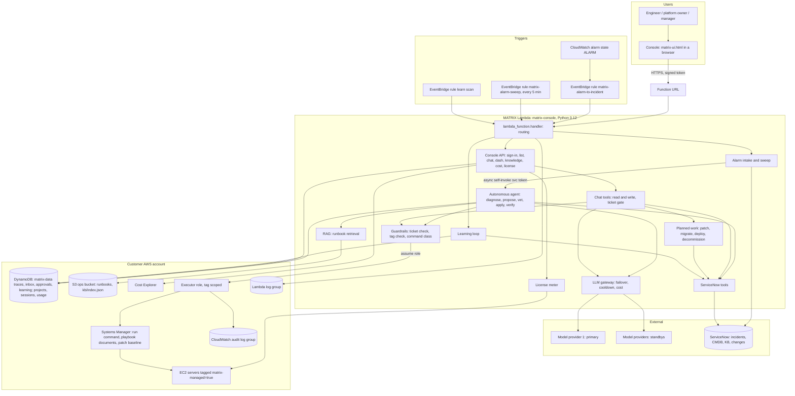
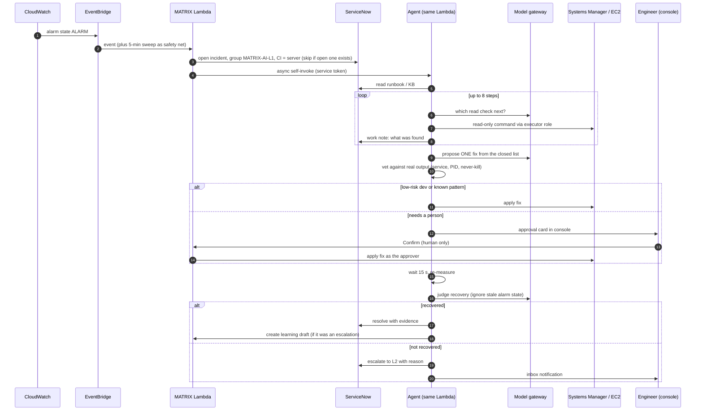
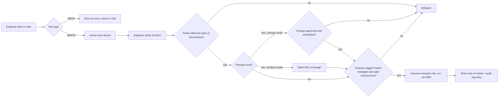
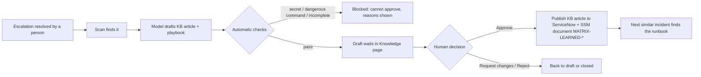
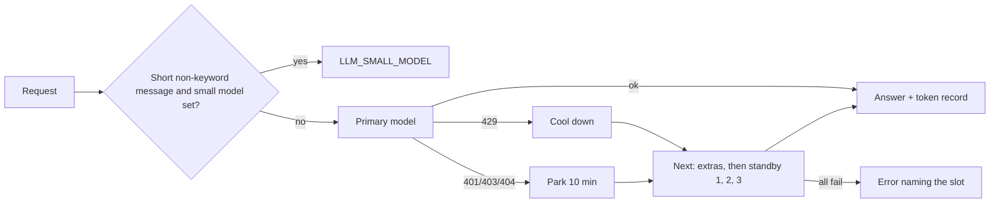
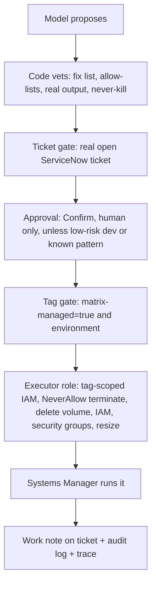

# MATRIX AIOps: Complete Product Reference (for building architecture diagrams)

Everything about the product in one place: purpose, functions, components, technology, data, flows, security, phases and
limits. Each section is written so it can be turned directly into a diagram. Mermaid diagrams are included and can be pasted
into any Mermaid viewer, draw.io (Arrange > Insert > Advanced > Mermaid) or Lucidchart.

Detail behind this file: PRD-001, ARC-001, AIG-001, DEP-001, COM-001, SEC-001, RSK-001, SUP-001, LIC-001, MTX-01 to MTX-04.

---

## 1. One-line summary

**MATRIX is an autonomous L1 site reliability engineer for AWS and ServiceNow.** It turns a CloudWatch alarm into a ServiceNow
incident, investigates the server, applies one safe fix (or asks a person to approve it), verifies the result, and resolves or
escalates, writing every step on the ticket. It runs as **one Python AWS Lambda** in the customer's own AWS account.

| Item | Value |
|---|---|
| Product name | MATRIX AIOps |
| Repository | GitHub `akaravind456-spec/Matrix-aiops`, branch `main` |
| Team | Aravind and Shafeeq |
| Runtime | AWS Lambda, Python 3.12, 512 MB, timeout 300 s, Function URL (auth type NONE; app-level signed token) |
| Region / account | One region and one AWS account per deployment (development: ap-southeast-2) |
| Ticketing | ServiceNow (REST API, integration user) |
| Server access | AWS Systems Manager only, no SSH, no inbound ports |
| Models | Any OpenAI-compatible endpoint with tool calling (tested: NVIDIA, Groq). Primary plus up to three standbys |
| Status | Pilot-ready draft. Linux servers only for autonomous fixes |

## 2. The problem and the value

| Problem | MATRIX answer |
|---|---|
| An alarm waits for a free engineer, especially at night | Incident opened and first checks started within about a minute |
| The fix depends on who is on shift | The same closed fix list runs every time |
| Notes are written afterwards or never | Every step is written on the ticket as it happens |
| Risky changes agreed by phone or chat | A Confirm button in the console, recorded with the person's name |
| Knowledge sits in people's heads | The agent follows runbooks, and drafts new ones from resolved tickets |

Value idea used in the pitch: five L1 engineers are needed to cover every hour (about $27,000 a month, assumption); if MATRIX
takes over 30% of the repeated work, about $8,000 a month of time is given back. MATRIX's own running cost in the pilot week
was under $1 plus $0.05 of model cost.

## 3. Users and roles

| Role | What they do |
|---|---|
| L1 / L2 engineer | Works incidents in the console, confirms or rejects fixes, takes ownership of escalations |
| Platform owner | Deploys MATRIX, manages settings, models, EventBridge, IAM, the fix list |
| Service manager | Reads the dashboard: autonomous rate, escalations, time to resolve, cost, licence use |
| Auditor | Reads ServiceNow work notes, the audit log group and the traces. No console seat needed |
| Server owner | Owns tagged servers; tags control scope |

Console sign-in: accounts defined in the `USERS` setting (username, name, role, ServiceNow user). Signed token (HMAC-SHA256,
8-hour life). The agent calls itself with a service token `svc:<AGENT_KEY>`; that identity can never approve anything.

## 4. Functionalities (feature list)

### 4.1 Autonomous L1 (alarm to resolution)
1. CloudWatch alarm enters ALARM.
2. Intake creates a ServiceNow incident (assignment group `MATRIX-AI-L1`, CI = the server's Name tag), with a duplicate guard.
3. The agent starts (async self-invoke).
4. RAG finds the matching runbook.
5. Diagnose with read tools (up to 8 steps): health, CPU, disk, services, processes, alarms.
6. Propose **one** fix from the closed list.
7. Vet the proposal in code against the real tool output.
8. Apply automatically, or create an approval card.
9. Wait about 15 seconds, re-measure, a model judges recovery (ignores stale alarm state).
10. Resolve with evidence, or escalate to L2 (group, state, inbox event).
11. A resolved escalation produces a learning draft.

**Closed fix list:** `restart_service` (allow-listed services only), `clear_old_logs`, `kill_process` (one process; the PID
and name must appear in the diagnostics; a never-kill list protects systemd, sshd, the SSM agent and similar).

**Approval rule:** automatic if (not `kill_process` and the environment is dev, development or test) or the alarm is a known
pattern (resolved automatically `AUTO_AFTER` = 3 times before). Otherwise an approval card waits for a human Confirm.

### 4.2 Chat (console)
Plain-language checks and confirmed actions. Read tools run at once. Write tools show an action card, need Confirm, and need a
valid, open ServiceNow ticket number. Results are written to the ticket.

### 4.3 Planned work tools (chat only, each behind approval)
| Area | Tools |
|---|---|
| Patching | `patch_scan`, `patch_status`, `patch_install` (rollback AMI first, `AWS-RunPatchBaseline`) |
| Migration | `migration_assess`, `migration_replicate`, `migration_image_status`, `migration_copy_image`, `migration_launch`, `migration_validate`, `migration_cutover`, `migration_rollback` |
| Deployment | `deployment_plan` (read), `deployment_apply` (SSM only, IMDSv2, encrypted disk) |
| Decommission | `decommission_assess`, `_snapshot`, `_stop`, `_terminate` (separate role, human tag, hold days), `snow_update_cmdb_ci`, `snow_close_change` |
| ServiceNow | create/search/update/link incidents, changes, problems; SR tasks; work notes (secrets masked); escalate; CMDB lookup; KB search; SLA; evidence attach |

`CHANGE_MODE=incident` runs planned work on incidents when the ServiceNow instance has no Change module; the Confirm button is
then the only approval.

### 4.4 Knowledge and learning
- Knowledge page: ServiceNow knowledge articles, AWS Systems Manager playbook documents, learning drafts, upload of SOPs (to
  ServiceNow KB) and playbooks (to SSM).
- Learning loop: after an escalation is resolved, draft an article and a playbook. Automatic checks block secrets, dangerous
  commands and incomplete articles. A person approves (the system cannot approve its own draft; `LEARN_SELF_APPROVE=0`).
  Approval publishes the KB article and SSM document `MATRIX-LEARNED-*`. Learned playbooks never join the agent's allow-list.

### 4.5 Dashboard
Open and escalated incidents, approvals waiting, autonomous rate, human-intervention rate, average time to resolve, recent
activity, AWS cost (gross before credits, credits shown separately), LLM cost (tokens times price table), Licence usage card.
`STATS_SINCE` hides old test events from rates.

### 4.6 Observability
Traces for every model call (model, tokens in/out, time, error), the state of every model in the LLM chain, token use,
inbox events, audit log of every action.

### 4.7 Cost and licensing
- Cost: Cost Explorer (cached 1 hour), LLM price table `LLM_PRICES`, optional `COST_TAG_KEY` filter. Chargeback method in COM-001.
- Licensing (proposed in LIC-001): plans Starter / Team / Commander priced on managed servers and approver seats. A usage meter
  (`matrix_license.py`, action `license`) shows usage against `LICENSE_PLAN`. Soft limits, nothing blocked, no signed key yet.

### 4.8 Resilience
Model failover: primary, same-key extras (`LLM_EXTRA_MODELS`), up to three standbys (`LLM_FALLBACK_*`, `_2`, `_3`), optional
small-talk model. 429 triggers a cooldown; 401, 403 and 404 park a slot for 10 minutes. If MATRIX is down, alarms and tickets
still exist and the five-minute sweep recovers missed alarms later.

## 5. Architecture (component view)

## 6. Code map (for module-level diagrams)

| Layer | File(s) | Purpose |
|---|---|---|
| Entry and routing | `lambda_function.py` | Handler. Alarm events and `matrix_task` schedules to their handlers, everything else to the console |
| Console API | `console_api.py`, `metrics.py`, `matrix_console_extras.py`, `matrix_cost_action.py`, `matrix_license.py` | Sign-in, incidents, chat, dashboard, knowledge, cost, licence |
| Alarm intake | `matrix_alarm_intake.py` | `on_event`, `sweep`, duplicate guard, `ALARM_MAX_PER_RUN`, `ALARM_PREFIX`, kicks the agent |
| Autonomous agent | `autonomy.py`, `aiops.py` | Diagnose, propose, `_vet`, `_apply_and_validate`, `_escalate` |
| Chat tools | `aiops.py`, `awsops.py`, `matrix_sre_install.py`, `matrix_sre_*` | Read and write tools, ticket gate (`precheck`) |
| Planned work | `matrix_ops_skills.py`, `matrix_ops_install.py`, `matrix_change.py`, `matrix_mode.py` | Patch, migration, deployment, decommission, change vs incident mode |
| ServiceNow | `matrix_snow_tools.py` | Ticket, CMDB, KB, change tools |
| Guardrails | `matrix_guardrails.py` | `validate_ticket`, instance tag check, command classes, role assumption, audit, `deploy_ec2` |
| Model gateway | `gateway.py` | Slots, failover, cooldown, 401/403/404 parking, small-talk model, usage and cost |
| Knowledge | `rag.py`, `matrix_console_extras.py` | Runbook retrieval, ServiceNow and SSM views, uploads |
| Learning | `learning.py` | Drafts, `_check`, approval, publish, scan |
| Close-out | `matrix_closeout.py` | Resolution notes and close handling |
| Console UI | `frontend/matrix-ui.html` | Single-file web console |
| Infrastructure | `infra/matrix-all.yaml` (built from `matrix-table`, `matrix-core`, `matrix-iam-executor`, `matrix-playbook`, `matrix-app`; `matrix-s3` optional) and `infra/matrix-alarm-events.yaml` | CloudFormation |
| Tools and tests | `tools/build-all-template.py`; `tests/` (63 offline unit tests) | Build and verify |

## 7. Technology stack

| Layer | Technology |
|---|---|
| Compute | AWS Lambda (Python 3.12), Function URL |
| Language / libraries | Python, boto3, standard library HTTP for model and ServiceNow calls |
| Triggers | CloudWatch Alarms, Amazon EventBridge (rules and a 5-minute schedule) |
| State | DynamoDB (trace table with TTL 30 days and point-in-time recovery; projects, sessions, usage tables) |
| Object storage | S3 ops bucket (runbooks, knowledge index) |
| Server actions | AWS Systems Manager (Run Command, documents `MATRIX_*`, patch baseline), assumed IAM executor role |
| Identity and scope | IAM roles with tag conditions (`matrix-managed`, `environment`), optional decommission role |
| Cost | AWS Cost Explorer API |
| Logging | CloudWatch Logs (Lambda log, audit log group) |
| Ticketing | ServiceNow REST (Table API) with an integration user |
| AI | OpenAI-compatible chat completions with tool calling; NVIDIA (free tier) and Groq tested; model IDs need the vendor prefix on NVIDIA |
| Retrieval | Runbook index JSON in S3 ranked by the model; no vector database |
| Front end | One HTML file with plain JavaScript; opened from a PC or hosted from S3 |
| Infrastructure as code | CloudFormation (one template plus the alarm-events stack), checked with cfn-lint |
| Testing | Python `unittest`, offline, 63 tests |
| Version control | Git, GitHub |

## 8. Workflows

### 8.1 Alarm to resolution (main flow)

### 8.2 Chat action with approval

### 8.3 Learning loop

### 8.4 Model failover

### 8.5 Stop ladder (kill switch)

| Level | Action | Effect |
|---|---|---|
| 1 | Disable EventBridge rules `matrix-alarm-to-incident`, `matrix-alarm-sweep` | No new alarm work |
| 2 | Clear `AGENT_KEY` | Agent never starts |
| 3 | Disable the learning scan | No new drafts |
| 4 | Deny-all on the executor role | Cannot act on servers |
| 5 | Throttle the Lambda (concurrency 0) | Everything rejected |
| 6 | Delete Function URL, disable model keys | No access, models stop |
| 7 | Deactivate the ServiceNow integration user | No ticket access |

## 9. Data stores

| Data | Store | Retention |
|---|---|---|
| Tickets, work notes, KB articles, CMDB | ServiceNow | Permanent record |
| Traces, inbox events, pending approvals, learning drafts | DynamoDB `matrix-data` (pk/sk/ttl) | 30 days |
| Projects, chat sessions, usage | DynamoDB tables `matrix-*` | Until deleted |
| Runbooks and index | S3 `matrix-ops-*` | Until deleted; kept on stack delete |
| Action audit | CloudWatch log group `/matrix/executor-audit-<env>` | Per retention setting |
| Playbooks | SSM documents (`MATRIX_*`, `MATRIX-LEARNED-*`, `MATRIX-PB-*`) | Versioned |
| Secrets (keys, passwords, tokens) | Lambda environment variables | Planned move to Secrets Manager |

## 10. Security and governance model

| Control | Enforced by |
|---|---|
| Closed fix list; proposal vetting; never-kill list | `autonomy._vet`, `NEVER_KILL` |
| Ticket gate | `matrix_sre_install.precheck`, `matrix_guardrails.validate_ticket` |
| Human-only approval | Console API (agent identity rejected) |
| Tag scoping | IAM conditions on the executor role |
| Hard denies | `NeverAllow` statement in the role (AWS enforces) |
| Separate decommission role | Optional, human tag `decommission-approved=true`, hold days |
| Secret masking | `_clean` in ServiceNow tools; learning `_check` |
| Duplicate guard and run cap | `matrix_alarm_intake` |
| Learning approval by a person | `LEARN_SELF_APPROVE=0` |

Trust boundaries: B1 browser to Function URL; B2 Lambda to model provider (prompts not redacted); B3 Lambda to ServiceNow;
B4 Lambda to servers (assume-role, SSM); B5 EventBridge to Lambda.

Known weaknesses (open): secrets in Lambda settings; console passwords in clear text, no SSO or MFA; public Function URL with
`ALLOWED_ORIGIN=*` by default; prompts unredacted; hand deployment with no signing; no penetration test; stop procedure not drilled.

## 11. Deployment architecture

| Item | Detail |
|---|---|
| Install | Create an S3 bucket and upload `dist/matrix-lambda.zip` (all `.py` files at the top level); create the CloudFormation stack from `infra/matrix-all.yaml` and fill the form; copy the `FunctionUrl`; open `matrix-ui.html`; tag a test server; deploy `infra/matrix-alarm-events.yaml` |
| Created resources | Lambda, Function URL, log group, Lambda role, DynamoDB tables, ops bucket, executor role, instance profile, audit log group, SSM documents, EventBridge learn-scan rule (alarm rules in the second stack) |
| Network | Lambda not in a VPC; outbound HTTPS to models and ServiceNow; servers call out to SSM; no inbound ports |
| Environments | `Environment=dev` allows auto low-risk fixes; use one stack per environment for test and prod |
| Upgrade / rollback | Upload the new or previous zip and Deploy; always test `{"matrix_task":"alarm_sweep"}` and check for import errors |
| Remove | Disable rules, delete the stack, empty the ops bucket if wanted |

Key settings (names only): `SN_BASE`, `SN_USER`, `SN_PASS`, `TOKEN_SECRET`, `AGENT_KEY`, `USERS`, `LLM_*` (primary, extras,
fallbacks, small model, prices), `ENVIRONMENT`, `EXECUTOR_ROLE_ARN`, `OPS_BUCKET`, `TRACE_TABLE`, `L1_GROUP`, `ALARM_PREFIX`,
`ALARM_MAX_PER_RUN`, `AUTO_AFTER`, `CHANGE_MODE`, `KB_NAME`, `STATS_SINCE`, `COST_TAG_KEY`, `LICENSE_PLAN`, `LICENSE_NAME`,
`LICENSE_SERVERS`, `LICENSE_SEATS`, `ALLOWED_ORIGIN`. See `env-template.md`.

## 12. Phases

### 12.1 How the product was built (delivered)
| Phase | What was delivered |
|---|---|
| 1. Core console | Lambda, chat agent, ServiceNow tools, dashboard, traces |
| 2. Resilience | LLM gateway with failover to NVIDIA and Groq, cooldowns, 401/403/404 handling, small-talk model |
| 3. Ops tools | Patching, migration, deployment, decommission, scoped executor role, SSM playbooks |
| 4. Lift and shift | One CloudFormation template, one form, deployment guide |
| 5. Console upgrades | LLM cost from token prices, AWS cost gross vs credits, escalation lists, Knowledge page, uploads |
| 6. Autonomous L1 | Alarm intake, sweep, agent, approvals, post-fix verification, escalation |
| 7. Incident mode | Planned work on incidents for instances without a Change module |
| 8. Learning loop | Drafts, checks, human approval, KB and SSM publish |
| 9. Product documents | PRD, ARC, AIG, DEP, COM, SEC, RSK, SUP, customer pack MTX-01 to 04, speaker script |
| 10. Licensing | Plans and prices (LIC-001), Licence usage meter |

### 12.2 How a customer adopts it
| Stage | MATRIX does | People do | Setting |
|---|---|---|---|
| 1. Tickets only | Opens, assigns and fills the incident | Fix as today | Clear `AGENT_KEY` |
| 2. Engineers confirm | Diagnoses and proposes; waits for Confirm | Confirm or reject cards | Non-dev `environment`, high `AUTO_AFTER` |
| 3. Automatic for routine work | Low-risk dev fixes and known patterns run alone | Review monthly, improve runbooks | Defaults for dev servers |

Pilot: 60 days, up to 10 servers, stage 2 first.

### 12.3 Roadmap
| Horizon | Item |
|---|---|
| Next | Secrets in Secrets Manager; hashed passwords or SSO with MFA; deployment pipeline with signing; rehearsed stop and restore |
| Next | Per-team chargeback report; average time to resolve honouring `STATS_SINCE`; alert emails |
| Next | Signed licence file; second ticketing adapter; Windows fixes; replay test of simulated incidents |
| Later | More pre-approved routine fixes; central view across accounts; penetration and prompt-injection testing |
| Long term | Recurring causes fed back to engineering |

## 13. Scalability and limits

| Dimension | Today |
|---|---|
| Ticket volume | Lambda scales; model rate limits bind first (NVIDIA free tier about 40 requests a minute). Add standbys |
| Alarm bursts | `ALARM_MAX_PER_RUN` (default 5) per sweep |
| Servers | A tag per server, no per-server software; large fleets not yet measured |
| Accounts / regions | One stack per account and region, no central view |
| Ticketing tools | ServiceNow only |
| Server types | Linux on EC2 through SSM |
| Availability | Single Lambda, no multi-region failover; nothing is lost if down |

Observed figures (development account, 7 days): 129 model calls across three models, about 439,000 tokens in and 25,800 out,
model cost about $0.05; other AWS about $0.94 gross; one observed run about 3 minutes from ticket to escalation including a
human approval. Real incidents traced end to end: INC0010006 to INC0010008.

## 14. Licensing and pricing (proposed, see LIC-001)

| Per year | Starter | Team | Commander |
|---|---|---|---|
| Managed servers / seats | 25 / 2 | 100 / 10 | Unlimited / 50 |
| Licence | $3,600 | $18,000 | $60,000 |
| Standard support 18% | $648 | $3,240 | $10,800 |

Counted: managed servers (EC2 with `matrix-managed=true` and the stack's environment) and approver seats (`USERS`). Soft limits;
not enforced; prices are drafts pending finance and legal.

## 15. Suggested architecture diagrams to draw

| Diagram | Use sections |
|---|---|
| 1. System context (users, ServiceNow, AWS, models) | 1, 3, 5 |
| 2. Component or container diagram of the Lambda | 5, 6 |
| 3. Alarm-to-resolution sequence | 8.1 |
| 4. Governance and approval layers | 8.2, 10 |
| 5. Data and storage map | 9 |
| 6. Deployment view (stack resources, network) | 11 |
| 7. Failover and learning loops | 8.3, 8.4 |
| 8. Adoption phases and roadmap timeline | 12 |
