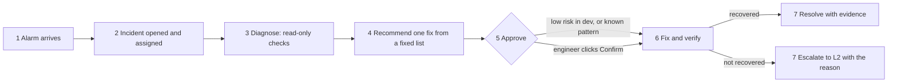
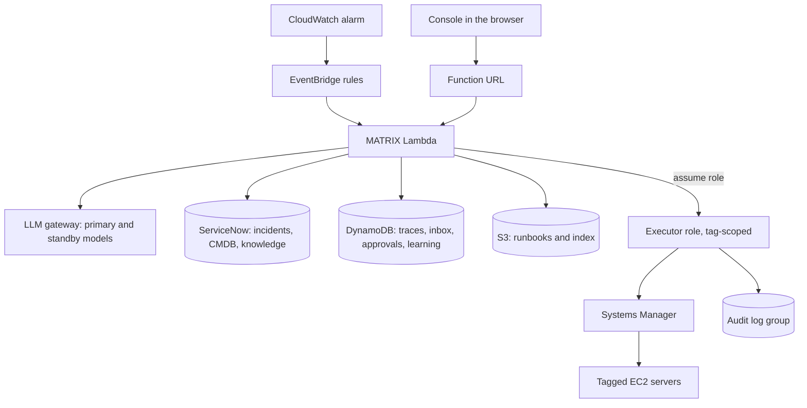

# MATRIX: Product Features, Architecture and Technology Stack

| Field | Value |
|---|---|
| Document ID | MTX-02 |
| Owner | MATRIX product owner |
| Version / status | 0.1 / Draft |
| Classification | Customer-shareable after review |
| Effective date | 18 November 2026 |
| Applies to | MATRIX AIOps (this repository, `main`) |
| Companion documents | MTX-01 (problem and approach), MTX-03 (deployment, cost, support), MTX-04 (security and AI observability) |
| Detail behind this summary | PRD-001, ARC-001, AIG-001, `tool-catalog.md` |

## 1. What MATRIX is

MATRIX is an autonomous L1 site reliability engineer that works inside your ServiceNow queue and your AWS account. It
picks up CloudWatch alarms, opens the incident, checks the affected server, writes what it found on the ticket, fixes what is
safe to fix, and hands everything else to a person with a clear reason. Anything risky needs a human to approve it first.

| Who is involved | What they do |
|---|---|
| Engineer (L1 or L2) | Works incidents in the console, confirms fixes, takes ownership of escalations |
| Platform owner | Deploys MATRIX, manages settings, models and the fix list |
| Service manager | Reads results, escalations and cost on the dashboard |
| Auditor | Reads the work notes, the audit log and the traces without acting |

## 2. Product features

### 2.1 Automatic alarm-to-fix
Alarms become incidents within about a minute. The agent searches your runbooks, runs read-only checks (health, CPU, disk,
services, alarms), proposes one fix, checks it in code, applies it or asks, measures again, and resolves or escalates. The fix
list is closed: restart an allow-listed service, clear old logs, or kill one runaway process.

### 2.2 Chat
Engineers ask in plain language. Read checks run at once. Changes show an action card and run only when the engineer
confirms, against a real, open ServiceNow ticket. Every result is written to the ticket.

### 2.3 Planned work
Patching (with a rollback image first), migration (image, copy, launch, validate, cutover, rollback), new server deployment,
and a staged decommission. Each step is a confirmed action behind a ticket. See `tool-catalog.md`.

### 2.4 ServiceNow tools
Create, search, update and link incidents, changes and problems; knowledge search; CMDB lookups; SLA; work notes with secrets
masked. If the ServiceNow instance has no Change module, planned work runs on incidents instead (`CHANGE_MODE=incident`).

### 2.5 Knowledge and learning
The agent follows your runbooks. The Knowledge page lists ServiceNow articles and AWS Systems Manager playbooks, uploads
new SOPs and playbooks, and shows **learning drafts**: after an escalation is resolved, MATRIX drafts an article and a
playbook. Automatic checks block secrets, dangerous commands and incomplete articles. A person approves, and approval
publishes the article to ServiceNow and the playbook to Systems Manager. The system cannot approve its own draft.

### 2.6 Dashboard and cost
Open and escalated incidents, approvals waiting, autonomous rate, human-intervention rate, time to resolve, AWS cost (before
credits, with the credits shown separately) and model cost from token prices.

### 2.7 Observability
Traces for every model call, token use, and the state of every model in the chain. See MTX-04.

### 2.8 Why an agent, not another tool

| Tool | What it does | What MATRIX adds |
|---|---|---|
| Monitoring (CloudWatch) | Tells you something is wrong | Acts on it, then checks it worked |
| Scripts and runbook automation | Do exactly what they were told | Chooses which checks to run, explains why, writes the notes, learns from the outcome |
| A copilot or chatbot | Suggests what you could do | Does it, inside limits you control, and records it |

### 2.9 What it is not
- Not a monitoring tool: it reacts to the alarms you already define.
- Not a chatbot that only advises: it acts, within limits you control.
- Not a replacement for engineers: it removes the waiting, the repetition and the copy-and-paste.
- It does not act on servers you have not tagged as managed.

## 3. Product architecture

MATRIX is **one Python AWS Lambda** with a web console. It has no servers to patch and no database to run.

| Part | What it does |
|---|---|
| Alarm intake | Turns an alarm into an incident, with a duplicate guard and a five-minute sweep |
| Agent | Diagnoses, proposes one fix, vets it, applies or asks, verifies, resolves or escalates |
| Chat tools | Read tools run at once; write tools need Confirm and a valid ticket |
| Guardrails | Ticket check, instance tag check, command class, role assumption, audit |
| LLM gateway | The only path to the models: failover, cooldowns, token and cost records |
| Knowledge and learning | Runbook retrieval, ServiceNow and SSM views, learning drafts |
| State | DynamoDB for traces, inbox, approvals and drafts (30-day expiry); S3 for runbooks; ServiceNow is the permanent record |

### 3.1 Governance: what decides what is allowed

| Decision | Defined by | Enforced at run time by |
|---|---|---|
| Which servers may be touched | The tags `matrix-managed=true` and `environment` | IAM conditions on the executor role. An untagged server cannot be acted on |
| What the agent may do on its own | The closed fix list | `autonomy._vet`, which checks the service, process ID and name against the real check output |
| Which processes are never killed | A never-kill list (systemd, sshd, the SSM agent and similar) | The same vetting step |
| Whether a change is authorised | A real, open ServiceNow ticket; for planned work an approved change (or an open incident in incident mode) | The ticket gate, before every write |
| What can never happen | IAM `NeverAllow`: terminate, delete volume, security-group and IAM changes, resize | AWS itself |
| Who approves | The engineer pressing Confirm. Human-only: the agent's own identity cannot approve | The approval check in the API |

### 3.2 Who decides what

| Action | Who decides |
|---|---|
| Read-only checks, work notes, resolve or escalate | The agent runs it |
| Restart a service or clear logs on a development server | The agent runs it (low risk) |
| The same on a non-development server | The engineer's Confirm, unless the same alarm was resolved three times automatically |
| Kill a process | The engineer's Confirm, always |
| Patching, migration, deployment | The engineer's Confirm, behind a ticket |
| Terminate a server | Not possible with the normal role. Only through an optional separate role, a human-added tag and a hold period |

### 3.3 Model gateway
All model traffic goes through one gateway.

| Control | How |
|---|---|
| Identity | An API key per model slot, held in settings |
| Allowed models | A primary, same-key extras, and up to three standbys. The model cannot choose its own provider |
| Failover | A rate-limited model is cooled down; a rejected key (401, 403) or missing model (404) is skipped for 10 minutes; the next model answers |
| Small-talk model | An optional cheaper model for short, simple chat messages |
| Visibility | Every call is recorded with its model, tokens, time and error |

### 3.4 Trust boundaries

| # | Boundary | What crosses it |
|---|---|---|
| B1 | Browser to the Function URL | Sign-in, requests, approvals |
| B2 | Lambda to the model provider | Prompts and answers (not redacted) |
| B3 | Lambda to ServiceNow | Tickets, CMDB, knowledge, under the integration user |
| B4 | Lambda to the servers | Commands through Systems Manager, under the scoped executor role |
| B5 | AWS to AWS | Alarm events, through EventBridge |

## 4. Technology stack

| Layer | Technology | Notes |
|---|---|---|
| Application | Python 3.12 on AWS Lambda | One function, 512 MB, 300 second timeout |
| Entry points | Lambda Function URL; EventBridge rules | Console API; alarm and schedule events |
| Models | Any OpenAI-compatible endpoint that supports tool calling | Tested with NVIDIA and Groq; no model is built in |
| State | DynamoDB (point-in-time recovery on); S3 | Traces, inbox, approvals, drafts; runbooks and index |
| Server access | AWS Systems Manager, through a tag-scoped IAM role | No SSH, no inbound ports |
| Ticketing | ServiceNow REST API | An integration user |
| Knowledge search | Runbook index in S3, ranked by the model | No vector database |
| Playbooks | AWS Systems Manager documents | Versioned |
| Cost | AWS Cost Explorer; model price table (`LLM_PRICES`) | Cached for an hour |
| Infrastructure | CloudFormation (one template, optional alarm-events stack) | Checked with `cfn-lint` |
| Console | One HTML file | Opened from a PC, or hosted in S3 for a team |
| Tests | Python `unittest`, offline | 52 tests |

## 5. Works with

| Area | Supported |
|---|---|
| Ticketing tools | ServiceNow |
| Servers | Linux on EC2, managed through Systems Manager |
| Cloud | AWS (EC2, Systems Manager, CloudWatch, EventBridge, DynamoDB, S3, Cost Explorer) |
| Models | Any OpenAI-compatible endpoint with tool calling, with up to three standbys |
| Change records | Real Change requests, or incidents when there is no Change module |

## Change history
| Version | Date | Author | Summary | Approval |
|---|---|---|---|---|
| 0.1 | 18 Nov 2026 | Product owner | First draft | Pending |
