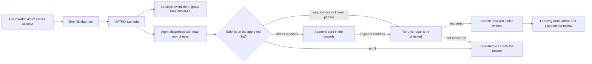

# MATRIX: Product Overview

| Field | Value |
|---|---|
| Document ID | PRD-001 |
| Owner | MATRIX product owner |
| Approver | `[to be named]` |
| Version / status | 0.1 / Draft |
| Classification | Internal; shareable after review |
| Effective date | 18 November 2026 |
| Review frequency | At every release, and after any change to the supported tools or the fix list |
| Applicable product version | MATRIX AIOps (this repository, `main`) |
| Related | ARC-001 (architecture), AIG-001 (agent behavior), DEP-001 (deployment), COM-001 (cost and chargeback), SEC-001 (security), RSK-001 (stop procedure), SUP-001 (support) |

## 1. What MATRIX is

MATRIX is an **autonomous L1 site reliability engineer for AWS and ServiceNow**. It watches your CloudWatch alarms, opens the
ServiceNow incident, checks the affected server, writes what it found on the ticket, fixes what is safe to fix, and hands
everything else to a human L2 engineer with a clear reason. Anything risky needs an engineer to press **Confirm** first.

It runs as **one Python AWS Lambda** with a web console. There is no server to patch and no database to run.

## 2. The problem it solves

Most L1 incidents repeat: a service has stopped, a disk is full, one process is using all the CPU. Each needs the same first
checks before anyone can decide what to do. That work is slow at night, differs from engineer to engineer, and fills the
queue with tickets a playbook could handle.

| Today | With MATRIX |
|---|---|
| An alarm fires and waits for a free engineer | The incident is opened and the first checks start within about a minute |
| The fix depends on who is on shift | The same approved fix list runs every time |
| Notes are written afterwards, if at all | Every step and action is written to the ticket as it happens |
| Risky changes are agreed by phone or chat | The engineer confirms in the console and the action is recorded |
| Knowledge sits in people's heads | The agent follows your runbooks, and new knowledge is drafted from resolved tickets |

## 3. How it works

1. **An alarm arrives.** An EventBridge rule calls the Lambda the moment an alarm enters ALARM. A five-minute sweep catches any it missed.
2. **An incident is created** and assigned to the AI group, with the server (CI) filled in. A second alarm for the same open incident is not duplicated.
3. **The agent diagnoses.** It searches the knowledge base for the matching runbook, then runs read-only checks (health, CPU, disk, services, alarms).
4. **It proposes one fix** from a fixed list, and the platform vets the proposal against the real diagnostic output.
5. **A human approves when needed.** Low-risk fixes in dev, and patterns the agent has resolved before, run automatically; the rest wait for Confirm.
6. **It verifies.** After the fix it re-measures. If the problem is gone the incident is resolved; otherwise it is escalated.
7. **It learns.** A resolved escalation produces a draft article and playbook that a human reviews in the Knowledge page.

## 4. What it can do

| Area | What the console and agent offer |
|---|---|
| Autonomous L1 | Alarm to incident to diagnosis to fix to verification, on a fixed catalogue: restart a listed service, clear old logs, kill one runaway process |
| Chat | Plain-language checks (health, CPU, memory, disk, alarms, processes, services, cost) and confirmed actions, each with the ticket gate |
| Planned work | Patching, migration (AMI, launch, cutover, rollback), new server deployment, and a staged decommission, each behind approval (see `tool-catalog.md`) |
| ServiceNow | Create, search, update and link incidents, changes and problems; knowledge search; CMDB lookups; work notes with secrets masked |
| Knowledge | The Knowledge page lists ServiceNow articles and AWS Systems Manager documents, reviews learning drafts, and uploads new SOPs (to ServiceNow) and playbooks (to SSM) |
| Dashboard | Open and escalated incidents, approvals, autonomous rate, human-intervention rate, time to resolve, AWS cost and LLM cost |
| Observability | Traces, token use and the state of every model in the LLM chain |
| Resilience | A primary model plus up to three standby models; a rejected or missing model is skipped automatically |

## 5. Who uses it

| Role | What they do with MATRIX |
|---|---|
| L1 and L2 engineers | Work incidents in the console, approve or reject fixes, take ownership of escalations |
| Platform owner | Deploys and updates MATRIX, manages settings, models and the fix list |
| Service manager | Reads the dashboard: autonomous rate, escalations, time to resolve, cost |
| Auditor | Reads work notes on tickets, the audit log group and the traces |

## 6. Works with

| Area | Supported |
|---|---|
| Ticketing | ServiceNow (REST API with an integration user) |
| Cloud | AWS: EC2, Systems Manager, CloudWatch, EventBridge, DynamoDB, S3, Cost Explorer |
| Server access | AWS Systems Manager only (no SSH, no open inbound ports) |
| Models | Any OpenAI-compatible endpoint that supports tool calling; tested with NVIDIA and Groq |
| Change records | Real Change requests, or incidents when the ServiceNow instance has no Change module (`CHANGE_MODE=incident`) |

## 7. Safety and control

- **The fix list is fixed.** The autonomous agent can only restart an allow-listed service, clear old logs or kill one process whose ID it read from the diagnostics.
- **The model is not trusted.** Every proposal is checked in code against the tool output before anything runs.
- **Scope is explicit.** Only EC2 instances tagged `matrix-managed=true` and the right `environment` can be touched, through a scoped IAM role.
- **Humans approve risk.** Changes from chat need Confirm and a valid ticket number; planned work needs an approved change (or an open incident in incident mode).
- **Hard limits in IAM.** The normal executor role is denied terminate and resize. Terminate exists only in a separate, optional role and needs a human tag.
- **Everything is recorded.** Work notes on the ticket, an audit log group, and traces for every model call.
- **It can be stopped in minutes.** See RSK-001.

## 8. What it is not

- It is **not** a monitoring tool: it reacts to the CloudWatch alarms you already define.
- It is **not** a chatbot that only advises: it acts, within limits you control.
- It does **not** replace engineers: it removes the waiting and the repetition.
- It does **not** touch servers you have not tagged as managed.

## 9. Requirements and limits

- An AWS account in one region, and a ServiceNow instance with an integration user that can read and write incidents, CMDB and knowledge.
- At least one model API key. NVIDIA's free tier is rate limited (about 40 requests a minute), so configure a standby.
- Servers need the SSM agent, the instance profile from the stack, and the two tags.
- A knowledge base named in `KB_NAME` must exist in ServiceNow before uploads and learning approvals can publish.
- Sign-in accounts are defined in the `USERS` setting; there is no single sign-on in this release (see SEC-001).
- The agent's fixes are Linux-only today.
- Licensing: plans are priced on managed servers and approver seats (proposed in LIC-001). The Dashboard Licence card
  measures usage against the plan set in `LICENSE_PLAN`; nothing is blocked.

## 10. Where to go next

| You want to | Read |
|---|---|
| Install it in an AWS account | DEP-001, then `deployment-guide.md` |
| Understand what it costs and how to charge teams | COM-001 |
| See how it is built and governed | ARC-001, AIG-001, SEC-001 |
| Know how to stop it | RSK-001 |
| Fix a problem | SUP-001 |
| See every tool and setting | `tool-catalog.md`, `env-template.md` |

## Change history
| Version | Date | Author | Summary | Approval |
|---|---|---|---|---|
| 0.1 | 18 Nov 2026 | Product owner | First draft from the code and the deployed behaviour | Pending |
